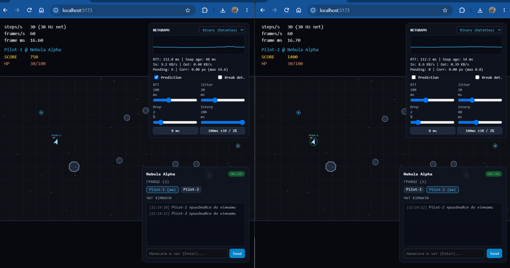
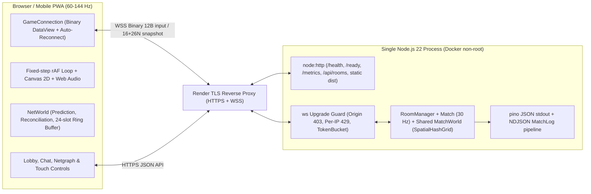
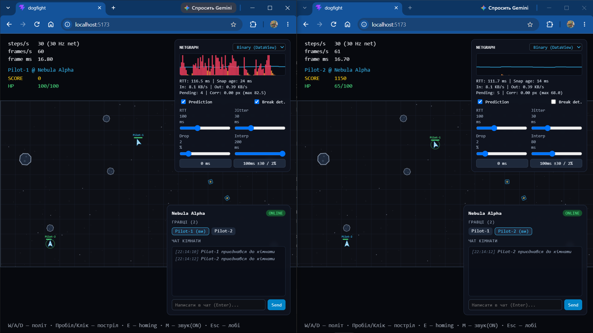
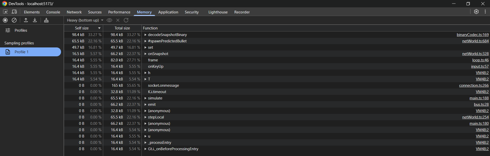
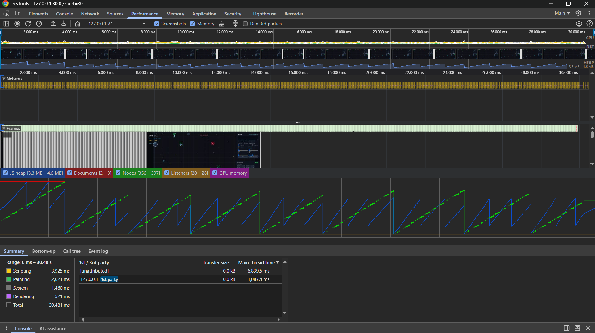
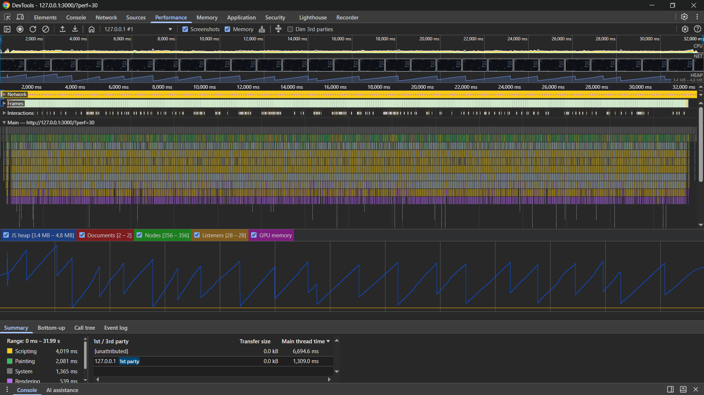
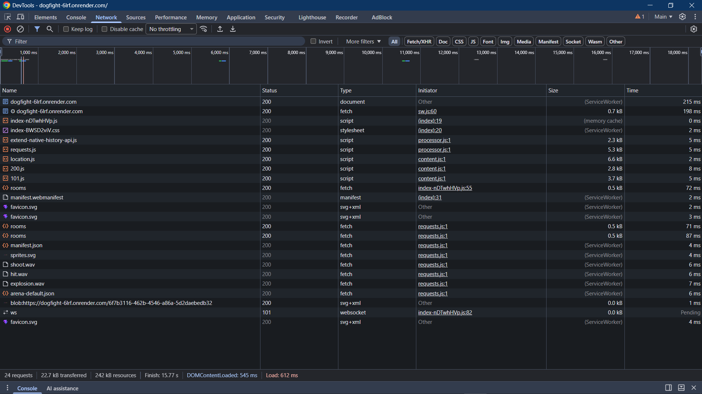
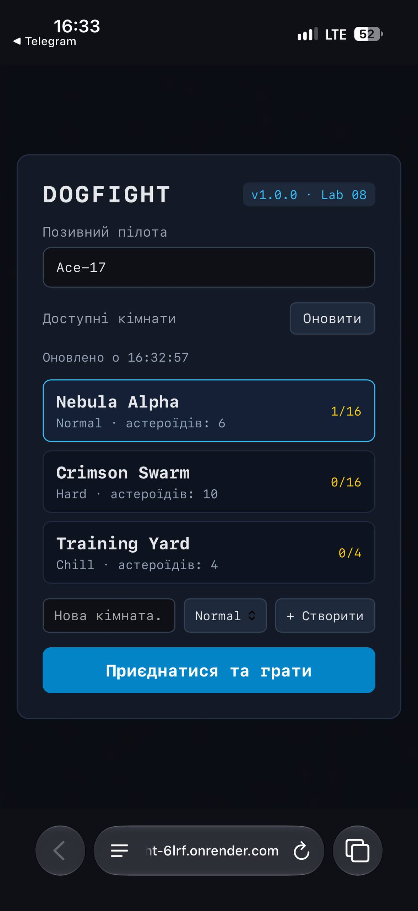
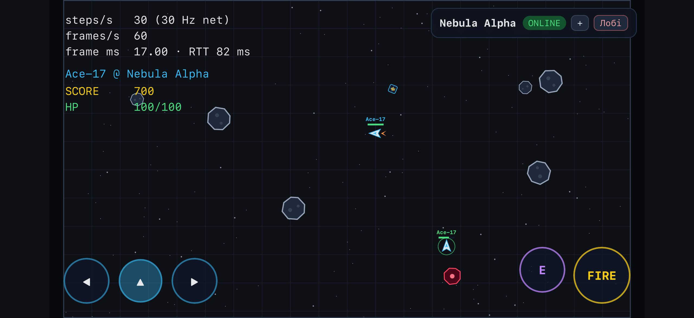
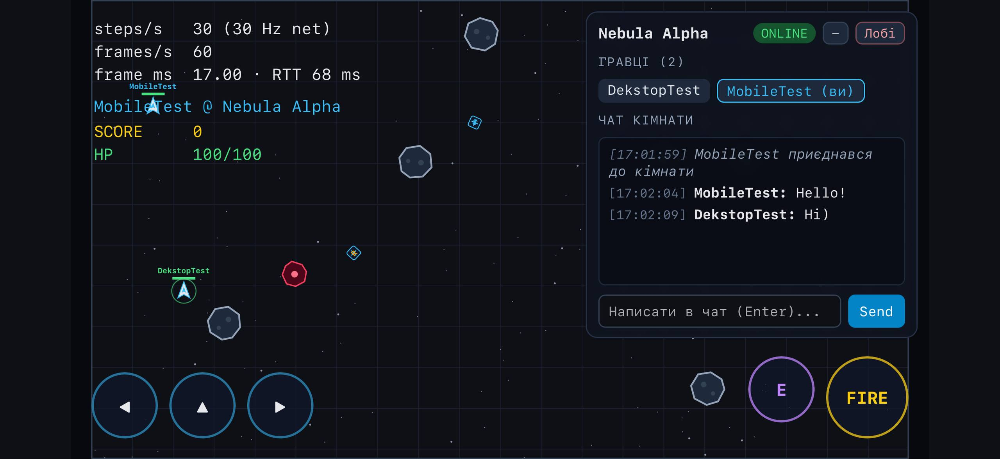

# dogfight

[](https://github.com/Kloyn1zM/dogfight/actions/workflows/ci.yml)



Мультиплеєрна 2D космічна арена в реальному часі (клієнт на Canvas 2D + Web Audio + PWA, авторитетний сервер на Node.js 22 + WebSocket binary protocol, спільна детермінована симуляція на суворому TypeScript).

- **Жива адреса (`https://` + `wss://`):** [https://dogfight-6lrf.onrender.com](https://dogfight-6lrf.onrender.com) *(ендпоїнти: [`/health`](https://dogfight-6lrf.onrender.com/health), [`/ready`](https://dogfight-6lrf.onrender.com/ready), [`/metrics`](https://dogfight-6lrf.onrender.com/metrics))*
- **Реальний RTT (дві різні мережі — ПК Wi-Fi + iPhone LTE PWA):** **`47–50 ms`** (ПК Wi-Fi) / **`68–82 ms`** (iPhone LTE, стабільні 60 FPS і 30 Hz `wss://` у спільній кімнаті)

### Як грати
- **ПК:** `W` / `↑` — тяга, `A` / `D` або `←` / `→` — поворот, `Пробіл` або ЛКМ — постріл, `E` — самонавідна ракета, `M` — звук, `Esc` — повернутися в лобі.
- **Телефон (PWA):** відкрийте публічне посилання в Chrome/Safari → «Додати на головний екран» / «Встановити додаток». На сенсорних пристроях автоматично з'являються екранні кнопки керування (`◀`, `▲`, `▶`, `FIRE`, `E`).

### Архітектура системи



### Ключові зведені метрики (Labs 5, 7, 8)
- **Бінарний протокол (`DataView`, Lab 5):** **`7.04×` менше трафіку** (`926 B` vs `6516 B` на 35 сутностях) і **`21.5×` швидше** за JSON (`5.63 µs` vs `120.84 µs`).
- **Тести та якість (Lab 7–8):** **87 автоматизованих тестів** (Vitest + 6 `fast-check` property-тестів + fault-injection тести + Playwright 2-browser E2E), покриття `shared/` **`95.41%` statements / `96.79%` lines**, `0 any`, детермінізм 1000 кроків **`babcfb7b`**.
- **Оптимізація V8/GC (Lab 7):** пікова JS-робота кадру в Chrome знизилась із `15.5 ms` до **`10.5 ms` (-32%)**, DOM Nodes стабілізувалися (`356–356`), серверний тик на 128 кораблях прискорився на **-45%** (`0.7045 → 0.3886 ms`) завдяки `ObjectPool` + `SpatialHashGrid`.
- **Місткість одного процесу Node.js:** до **`128` активних гравців** (16 кімнат по 8 гравців) із `0 overruns`, `jitter p99 = 14.81 ms` та `RSS = 130.2 MB`; поріг деградації (`> 33.3 ms`) — **`256` клієнтів**.

### Обмеження архітектури та чому вони лишилися
1. **Усі гравці однієї кімнати мусять бути в одному процесі Node.js:** авторитетна симуляція `MatchWorld` працює в пам'яті з частотою 30 Hz (бюджет 33.3 мс). Поділ однієї кімнати між кількома серверами вимагав би міжпроцесної синхронізації стану фізики кожні 33 мс, що додало б мережеву затримку й складність консенсусу. Горизонтальне масштабування для такого класу ігор робиться шардингом *по кімнатах* (sticky routing за `roomId`).
2. **Ефемерна файлова система на Render Free Tier:** локальні NDJSON-реплеї очищуються після перезапуску контейнера; натомість структуровані `pino` JSON-логи стрімляться в `stdout` хостингу, а для постійного зберігання реплеїв знадобилося б об'єктне сховище (S3/R2).
3. **Cold start на безкоштовному тарифі (~30–60 с після 15 хв простою):** інстанс засинає без трафіку, щоб вкладатися в пул 750 годин/місяць.

---

## Lab 01 — The Event Loop Is the Game Loop

### Запуск локально

~~~bash
nvm use
npm install
npm run lint
npm run dev
~~~

### Архітектура та налаштування фізики
- **Ігровий цикл (`src/loop.js`):** фіксований крок симуляції `step = 1/60` с поверх `requestAnimationFrame` із клампом `maxDelta = 0.25` с (захист від «спіралі смерті» після фрізів або повернення з фонової вкладки). Рендер працює на частоті дисплея та інтерполює стан за `alpha = accumulator / step`.
- **Ввід (`src/input.js`):** замикання з приватними `Set` (`isDown`, `justPressed`, `consume`, `destroy`), ігноруванням `e.repeat` і системних шорткатів. Адаптер `readShipCommand` відділяє коди клавіш браузера від симуляції, формуючи чисту команду `{ turn: -1 | 0 | 1, thrust: boolean }`.
- **Симуляція (`src/sim/ship.js`, `src/sim/arena.js`):** чиста детермінована фізика без залежностей від DOM/Canvas та тороїдальний wrap-around арени з корекцією інтерполяції (`hideWrapForLerp`).
- **Параметри керованості (`src/sim/ship.js`):**
  - `ROTATE_SPEED = 3.6` рад/с — повний оберт ~1.75 с, зручно точно наводити ніс;
  - `THRUST = 520` px/с² — відчутний розгін без надмірної інерції;
  - `DRAG = 1.15` с⁻¹ — експоненційне гальмування `Math.exp(-DRAG * dt)`, стабільне при відпусканні газу;
  - `MAX_SPEED = 380` px/с — контрольована швидкість у межах екрана.
- **Рендер (`src/render/canvas.js`, `src/render/draw.js`):** DPR-aware canvas із ресайзом, інтерполяція кута по найкоротшій дузі (`lerpAngle`), полум’я тяги, сітка, зоряне поле та HUD.

---

### Експерименти M4

#### Експеримент 1: Синхронний `busy-wait` (100 мс кожен 60-й кадр у `render`)

**Заміри:**
- Звичайний `frame ms`: **`16.80 ms`**
- Піковий `frame ms`: **`100.00 ms`**
- `frames/s`: **`55`** (втрачено ~5 кадрів за секунду на дисплеї 60 Hz)
- `steps/s`: **`60`** (симуляція наздогнала пропущений час через акумулятор)

**Спостереження та пояснення (Event Loop):**
Раз на секунду картинка завмирає, а після відвисання корабель робить помітний ривок уперед. JavaScript у вкладці виконується в одному потоці за моделлю *run-to-completion*: поки синхронний `while (performance.now() < t + 100)` займає Call Stack, Event Loop не може ні виконати фазу рендеру (`rAF → style → layout → paint`), ні забрати наступну задачу з Task Queue (натискання клавіш, таймери). Жоден `Promise` чи `setTimeout` у цьому ж потоці не здатен перервати активну синхронну функцію — винести таке блокування можна лише в окремий потік (Web Worker).

---

#### Експеримент 2: `setInterval(frame, 16)` замість `requestAnimationFrame`

**Заміри:**
- Активна вкладка: `dt ms ≈ 17.00 ms` (дрейф таймера відносно VSync 16.67 ms)
- Фонова вкладка (5 с): `framesPerSecond: 1`, `frameTimeMs: 999.3 ms`, `stepsPerSecond: 15`, `workTimeMs: 0.6 ms`

**Пояснення:**
1. На відміну від `requestAnimationFrame`, який браузер повністю ставить на паузу в невидимій вкладці, `setInterval` продовжує спрацьовувати у фоні з тротлінгом ~1 раз/с (`~999.3 ms`). Завдяки клампу `maxDelta = 0.25 s` за один фоновий виклик виконувалося рівно `0.25 / (1/60) = 15` кроків (`stepsPerSecond: 15`), що захистило вкладку від зависання.
2. `16 ms ≠ 16.667 ms`, інтервал не прив’язаний до частоти оновлення монітора (60/120/144 Hz) і потрапляє в Task Queue, а не в рендер-крок перед `paint`, тому виникає джитер і пропуски кадрів.

---

#### Експеримент 3: Фіксований крок (`1/60` с) vs змінний крок (`simulate(dt)`) під 6× CPU throttling

**Методика:** старт із центру арени (`x = 491.0000`, курс строго вгору `-π/2`), автоматичне утримання тяги 5 секунд симуляції; порівняння координат `(x, y)` без обмежень і з `DevTools → Performance → CPU: 6x slowdown`.

| Режим CPU | Fixed timestep (`1/60` с) `(x, y)` | Variable timestep (`simulate(dt)`) `(x, y)` |
|---|---|---|
| **1× CPU (No throttling)** | `(491.0000, 255.9345)` | `(491.0000, 262.2426)` |
| **6× CPU slowdown** | `(491.0000, 255.9345)` | `(491.0000, 262.2806)` |

**Висновок:**
За фіксованого кроку `1/60` с результати при 1× і 6× CPU збіглися **з точністю до 4-го знака після коми** (`255.9345` vs `255.9345`). За змінного кроку `simulate(dt)` траєкторія залежить від реальної тривалості кадрів і розходиться як із фіксованою моделлю (~6.3 px), так і між 1× та 6× CPU (`262.2426` vs `262.2806`). Детермінізм фіксованого кроку є критичним для мультиплеєра та client-side prediction у Lab 5.

---

## Lab 02 — Objects, Prototypes, and `this`: The Entity Model

### Що реалізовано
- **`Vector2` (`src/sim/vector.js`):** чисті векторні операції (`add`, `sub`, `scale`, `length`, `normalize`, `rotate`, `dot`, `Vector2.fromAngle`) + in-place утиліти (`set`, `copy`, `addInPlace`).
- **Модель сутностей (`src/sim/entity.js`, `src/sim/ship.js`, `src/sim/entities.js`):** базовий `Entity` із приватним статичним лічильником `#nextId` та приватним `#id`; успадкування строго в **один рівень** (`Ship`, `Bullet`, `Asteroid`, `Pickup`, `Explosion` успадковують `Entity`). У `Ship` здоров’я `#hp`, щит і кулдауни захищені приватними полями.
- **Світ на базі `Map` (`src/sim/world.js`):** приватна колекція `#entities = new Map()`, ітератор `[Symbol.iterator]()`, генератор `*ofKind(kind)` без проміжних масивів і відкладене видалення `#sweep()` наприкінці кроку.
- **Колізії та геймплей (`src/sim/collision.js`, `src/sim/world.js`):** ізольована функція-генератор `detectCollisions(world)` (готова до заміни на spatial hash у Lab 7), пружні відскоки астероїдів, розкол великих астероїдів, вибухи з частинок, респаун через 2 с у безпечній точці та підрахунок очок у HUD.

### Баг із `this` у колбеках і як його виправлено
Під час підключення стрільби по кліку миші наївно передати метод напряму:

~~~js
// БАГ: функція відірвана від об'єкта — браузер викличе її з this === canvasEl
canvasEl.addEventListener('pointerdown', player.fire)
~~~

За правилами прив’язки `this` (пріоритет: `new` → `call`/`apply`/`bind` → `obj.m()` → default `undefined` у strict mode) у такому виклику `this` вказує на `<canvas>`, тому звернення до приватного поля `this.#fireCooldown` миттєво кидає `TypeError`.

**Обраний фікс (`src/main.js`):** стрілкова обгортка `() => { const p = world.getPlayer(); if (p) p.fire(world) }`.
- *Чому саме вона:* зберігає метод на `Ship.prototype` (не дублюється на кожен екземпляр) і коректно працює після респауну нового екземпляра `Ship`.
- *Альтернативи та їхні мінуси:*
  1. `player.fire.bind(player)` — створює нову функцію і прив’язує її назавжди до старого корабля (зламається після смерті й респауну, а ще ускладнює `removeEventListener`).
  2. Стрілкове поле класу `fire = () => { ... }` — не лежить на прототипі, а створює окреме замикання на кожному екземплярі (зайва пам’ять при великій кількості сутностей).

### Композиція замість глибокого успадкування (`src/sim/behaviors.js`)
У грі з’явилися дві механіки, які ламають класичну ієрархію класів:
1. **Самонаведення (`homing`)** потрібне одночасно і для ракети (`Bullet`, наводиться на астероїди), і для агресивного червоного астероїда (`Asteroid`, переслідує корабель).
2. **Бонус (`Pickup` — щит або скорострільність)** є стаціонарним об’єктом із колізією та ефектом, але не є ні кораблем, ні снарядом.

**Як би виглядала ієрархія через `extends`:**
Довелося б будувати дерево на кшталт `Entity → MovingEntity → Bullet → HomingBullet` і паралельно `Entity → MovingEntity → Asteroid → HomingAsteroid` — дублюючи код наведення у двох гілках (або вигадуючи множинне успадкування, якого в JS немає). Додавання будь-якої нової комбінації (наприклад, рухомий бонус або самонавідний щит) вибухово множило б кількість підкласів.

**Обране рішення (компоненти-поведінки в `entity.behaviors`):**
Кожна сутність тримає масив незалежних компонентів (`createHoming(...)`, `createPickupEffect(...)`), а `runBehaviors(entity, dt, world)` виконує їх під час `update`. Одна й та сама функція `createHoming` працює і для фіолетової ракети (`KeyE`), і для червоного астероїда-переслідувача, залишаючи ієрархію `extends` плоскою (максимум 1 рівень) і тривіальною для серіалізації в Lab 5.

---

## Lab 03 — Asynchronous JavaScript: Promises, `async`/`await`, and the Loading Screen

### Що реалізовано
- **Пайплайн завантаження (`src/assets/loader.js`):** `fetchJson` (перевіряє `response.ok` і кидає `HttpError`), `withRetry` (експоненційний backoff + jitter, без повторних спроб на `4xx`, `AbortError` та `SyntaxError`), `loadImage`, `loadAudio` (Web Audio `decodeAudioData`), `loadJson` — усі приймають `AbortSignal`. `loadAll` завантажує ресурси паралельно через `Promise.all` із підрахунком прогресу по кожному елементу.
- **Спрайти, Web Audio та розв’язка через `EventTarget` (`src/audio.js`, `src/render/hud.js`, `src/sim/world.js`):** сутності малюються зі спрайт-листа `public/assets/sprites.svg` через `drawImage` (із векторним fallback). `AudioContext` розблоковується кліком «Приєднатися». `World` лише емітить `CustomEvent` (`fired`, `hit`, `exploded`, `pickup`, `score`) на `world.events` і має **нуль імпортів** аудіо чи HUD.
- **HTTP-лобі (`src/lobby/lobby.js`, `src/lobby/lobbyView.js`):** `Lobby extends EventTarget` періодично оновлює `/api/rooms.json` із `AbortSignal.timeout(4000)` та при виході викликає `abort()` для скасування активних запитів; DOM-рендер повністю винесений у `lobbyView.js`.

### Порівняння швидкості: послідовний `await` vs паралельний `Promise.all` (5 асетів)

| Режим завантаження | URL-параметри | Час завантаження | Пояснення |
|---|---|---|---|
| **Concurrent (`Promise.all`), без затримки** | за замовчуванням (`delay=0ms`) | **`45.6 ms`** | Локальне паралельне завантаження й декодування 5 асетів. |
| **Concurrent (`Promise.all`), `delay=250ms`** | `/?delay=250` | **`289.7 ms`** | Усі 5 запитів стартують одночасно; загальний час ≈ `250 ms` + декодування. |
| **Sequential (`for ... await`), `delay=250ms`** | `/?delay=250&seq=1` | **`1316.0 ms`** | Кожен наступний запит чекає завершення попереднього (`~5 × 250 ms`); у **4.54×** повільніше за `Promise.all`. |

### П’ять головоломок порядку виконання (Task / Microtask / `await` / `rAF`)

1. **Синхронний код, мікрозадача та `await`:**
   ~~~js
   async function f() {
     console.log('A')
     await null
     console.log('B')
   }
   Promise.resolve().then(() => console.log('C'))
   f()
   console.log('D')
   ~~~
   - **Вивід:** `A`, `D`, `C`, `B`.
   - **Пояснення:** `A` і `D` виконуються синхронно; `C` потрапив у чергу мікрозадач раніше, ніж `await null` поставив туди продовження `B`.

2. **`setTimeout` усередині `.then`:**
   ~~~js
   setTimeout(() => console.log('1'), 0)
   Promise.resolve()
     .then(() => {
       console.log('2')
       setTimeout(() => console.log('3'), 0)
     })
     .then(() => console.log('4'))
   console.log('5')
   ~~~
   - **Вивід:** `5`, `2`, `4`, `1`, `3`.
   - **Пояснення:** після синхронного `5` повністю спустошується мікрочерга (`2`, потім `4`), і лише після цього по черзі виконуються макрозадачі `1` і `3`.

3. **Забутий `return` у ланцюжку промісів:**
   ~~~js
   Promise.resolve(10)
     .then((n) => { Promise.resolve(n + 5) })
     .then((v) => console.log('val:', v))
   ~~~
   - **Вивід:** `val: undefined`.
   - **Пояснення:** перший `.then` нічого не повернув, тому наступний проміс у ланцюжку резолвиться з `undefined`.

4. **`requestAnimationFrame` vs мікрозадача всередині rAF:**
   ~~~js
   requestAnimationFrame(() => {
     console.log('raf-1')
     Promise.resolve().then(() => console.log('micro-in-raf'))
   })
   requestAnimationFrame(() => console.log('raf-2'))
   ~~~
   - **Вивід:** `raf-1`, `micro-in-raf`, `raf-2`.
   - **Пояснення:** мікрочерга очищується після завершення кожного колбеку, тому мікрозадача з першого `rAF` відпрацьовує раніше за другий `rAF`-колбек того ж кадру.

5. **Подія (`EventTarget`) синхронна, а проміс — завжди асинхронний:**
   ~~~js
   const bus = new EventTarget()
   bus.addEventListener('ping', () => console.log('event'))
   Promise.resolve().then(() => console.log('promise'))
   bus.dispatchEvent(new Event('ping'))
   console.log('sync')
   ~~~
   - **Вивід:** `event`, `sync`, `promise`.
   - **Пояснення:** `dispatchEvent` викликає слухачів синхронно на тому ж стеку, а `.then` завжди відкладається в чергу мікрозадач.

### Галерея помилок M4 (Graceful Recovery)

| Сценарій | Як відтворено | Фактичний вивід у консолі | Відновлення в UI |
|---|---|---|---|
| **Відсутній спрайт (404)** | `/?fail=404` (`/assets/does-not-exist-404.svg`) | `[Loader] failed: Error Failed to decode image: /assets/does-not-exist-404.svg` *(Vite SPA fallback повернув HTML замість SVG; для реального 404 `loadImage` кидає `HttpError 404` без ретраїв)* | Показ помилки на екрані завантаження + кнопки «Повторити» та «Грати без асетів (fallback)» із векторною графікою. |
| **Таймаут мережі** | `/?fail=timeout` (`/api/dev-timeout`, `1200 ms`) | `[Loader] failed: TimeoutError signal timed out` *(після 3 спроб з експоненційним backoff)* | Повідомлення про таймаут + кнопки «Повторити», fallback або «Назад у лобі». |
| **Битий JSON** | `/?fail=corrupt` (`/api/dev-corrupt.json`) | `[Loader] failed: SyntaxError Expected double-quoted property name in JSON at position 18 (line 1 column 19)` *(без ретраїв)* | Помилка перехоплена в `try/catch`, гра не зависає; доступні повтор, fallback і повернення в лобі. |
| **Скасування (Abort)** | `/?delay=1200` + клік «Скасувати (Abort)» | `[Loader] failed: AbortError Скасовано користувачем` *(негайне скасування без ретраїв)* | Активні `fetch` перериваються через `AbortController`; користувач може повторити або повернутися в лобі. |

---

## Lab 04 — Node.js: `EventEmitter`, Streams, and a WebSocket Server

### Що реалізовано
- **Workspaces (`package.json`, `client/`, `server/`):** монорепозиторій на базі npm workspaces із `"type": "module"`, префіксами `node:` для вбудованих модулів і конфігурацією з `.env` (`node --env-file=../.env`, валідація в `server/src/config.js`).
- **HTTP-сервер (`server/src/index.js`):** чистий `node:http` без фреймворків — роздає зібраний `client/dist/` із MIME-типами та захистом від path traversal (`..`), надає JSON API (`GET/POST /api/rooms`, `GET /api/replays`, `GET /api/replays/:id`, `GET /health`), Vite проксує `/api`, `/ws`, `/health` у dev-режимі; реалізовано graceful shutdown на `SIGINT`/`SIGTERM` (закриття сокетів із кодом `1001`, зупинка HTTP-сервера, дозапис логів, `exit 0`).
- **Кімнати та WebSocket (`server/src/rooms.js`, `server/src/ws.js`, `server/src/protocol.js`):** `Room extends EventEmitter`, `RoomManager` з автовидаленням порожніх непостійних кімнат, версіонований JSON-протокол `v1` із суворою валідацією кожного повідомлення, таймаут на `join` (5 с), heartbeat `ping`/`pong` кожні 15 с (розрив після 2 пропусків), обов’язкові `'error'`-слухачі на всіх сокетах та емітерах.
- **Захист від зловживань (`server/src/ws.js`):** `maxPayload` (4 KB), per-socket token-bucket rate limiter (`20 msg/s`), ліміти на кількість кімнат (`20`) і гравців у кімнаті (`8`), slow-client policy за `socket.bufferedAmount` (відкидання некритичних повідомлень вище 64 KB та закриття сокета при переповненні > 256 KB).
- **Клієнт (`client/src/net/connection.js`, `client/src/ui/roomPanel.js`):** `GameConnection` із диспетчеризацією по `type`, чергою відправки під час підключення та автоперепідключенням з експоненційним backoff + jitter; живий список гравців (`roster`) та чат у двох вікнах браузера.
- **Стрімові логи матчів (`server/src/log/matchlog.js`, `server/src/log/replay.js`):** object-mode `JsonLinesTransform` + `pipeline()` у `server/logs/<room>-<timestamp>.ndjson`; читання через async-генератор `readReplayEvents` і стрімова віддача `GET /api/replays/:id` через `pipeline(createReadStream, res)`.

---

### Експеримент M3 — Backpressure під час стрімінгу `200 MB` реплею

Згенеровано синтетичний лог `200.0 MB` і завантажено через `GET /api/replays/bench-200mb` штучно уповільненим клієнтом (`~25 MB/s`, загальний час `8.0 s`) із заміром пам’яті сервера через `/health` щосекунди:

| Час (с) | Server RSS (MB) | Heap Used (MB) | Графік RSS (масштаб: 1 блок ≈ 5 MB) |
|---:|---:|---:|---|
| 0 | 46.50 | 8.83 | `█████████` |
| 1 | 52.86 | 8.68 | `███████████` |
| 2 | 63.59 | 9.01 | `█████████████` |
| 3 | 52.42 | 7.47 | `██████████` |
| 4 | 57.87 | 7.70 | `████████████` |
| 5 | 65.88 | 8.02 | `█████████████` |
| 6 | 52.27 | 7.49 | `██████████` |
| 7 | 58.63 | 7.77 | `████████████` |
| 8 | 58.50 | 7.86 | `████████████` |

**Висновок (Backpressure):**
Незважаючи на те, що файл важить `200 MB`, а клієнт читає повільно, RSS сервера залишився **пласким у діапазоні `46.5–65.9 MB`** (heap `7.5–9.0 MB`). Коли внутрішній буфер сокета `res` перевищує `highWaterMark`, `res.write()` повертає `false`; `stream.pipeline()` автоматично ставить `createReadStream` на паузу і відновлює читання з диска лише після події `'drain'`. Без backpressure буфер у пам’яті ріс би до сотень мегабайтів аж до OOM.

---

### Нотатка M4 — Node Event Loop, блокування потоку та неперехоплені помилки

#### 1. Фази Node.js Event Loop і демонстрація блокування на 300 мс
Node.js виконує JavaScript-код в **одному потоці** поверх циклу **libuv**:
`timers (setTimeout)` → `pending callbacks` → `poll (I/O: мережа, файли)` → `check (setImmediate)` → `close callbacks`, причому після кожної фази повністю спорожнюються `process.nextTick` та черга мікрозадач Promise. Файловий I/O і DNS працюють у пулі потоків libuv, але обробники запитів і WebSocket-повідомлень виконуються на одному головному потоці.

**Демонстрація (`GET /api/slow?ms=300` паралельно з активним WebSocket-клієнтом):**

~~~text
{
  normalWsPingMs: 2.61,
  during300msBlockPingMs: 327.79,
  afterBlockPingMs: 0.61,
  serverBlockedMs: 300.4
}
~~~

Поки один HTTP-запит тримав головний потік у синхронному `while` протягом `300.4 ms`, цикл libuv не міг повернутися у фазу `poll`, тому затримка **зовсім іншого** підключеного WebSocket-клієнта зросла з `2.61 ms` до `327.79 ms`. Це означає, що жодна важка синхронна операція не може виконуватись у запитах ігрового сервера.

#### 2. Чому неперехоплений `'error'` (і unhandled rejection) валить увесь сервер
У Node.js `EventEmitter` має спеціальне правило: якщо викликати `emit('error', err)` без жодного підписаного слухача `'error'`, рушій кидає виняток на верхній рівень і **аварійно завершує весь процес** (так само як `unhandledRejection` у сучасних версіях Node.js). Тому на кожному сокеті, `WebSocketServer`, `http.Server`, `Room` та потоках `pipeline()` обов’язково підключено явні обробники помилок.

---

## Lab 05 — Real-Time Networking: Authoritative Server, Prediction, and Binary Protocols

### Що реалізовано
- **Спільний пакет `@dogfight/shared` (`shared/src/`):** чиста детермінована симуляція (`MatchWorld`, `integrateShip`, сідований PRNG `mulberry32`, фіксована логічна арена `1280×720`, `TICK_RATE = 30 Hz`) без жодних DOM- або Node-залежностей (підтверджено ESLint із `globals: {}` та тестами в Node.js).
- **Авторитетний сервер (`server/src/match.js`, `server/src/ws.js`, `server/src/netSim.js`):** кожна активна кімната запускає власний `Match` на `30 Hz` із точним абсолютним таймером (`nextTick += 1000 / 30`), валідує всі вхідні команди (`seq`, `turn ∈ {-1, 0, 1}`, `thrust`, `fire`, `fireHoming`), віддає статистику тиків у `GET /api/stats` і пропускає трафік через інжектор затримки/джитеру/втрат (`NetSimulator`).
- **Клієнтський неткод (`client/src/net/netWorld.js`, `client/src/net/connection.js`, `client/src/ui/netPanel.js`):**
  - *Client-side prediction + Server reconciliation:* локальний корабель інтегрується миттєво через спільний `integrateShip`; непідтверджені команди зберігаються в буфері, при приході снапшота команди `<= lastProcessedSeq` відкидаються, решта програються заново, а розбіжність плавно гаситься за ~85 мс.
  - *Entity interpolation:* чужі кораблі, астероїди, кулі й бонуси буферизуються та інтерполюються в минулому (`now - interpolationDelayMs`, за замовчуванням `80 ms`, регулюється наживо) з коректним wrap-around і `lerpAngle`.
  - *Local bullet prediction:* власні кулі спауняться миттєво й замінюються авторитетними кулями сервера при збігу в снапшоті.
  - *Netgraph-оверлей:* показує RTT, вік снапшота, трафік `In/Out KB/s`, кількість непідтверджених інпутів і графік корекцій `Corr (px)`.
- **Бінарний протокол `v2` (`shared/src/codec/binaryCodec.js`):** little-endian `ArrayBuffer`/`DataView` (специфікація зафіксована в коді): `INPUT` — фіксовано 12 байтів; `SNAPSHOT` — 16-байтовий заголовок + `N × 26` байтів на сутність (кут квантизований у `Int16` із кроком `1/1000` рад ≈ `0.057°`). JSON-кодек доступний за живим перемикачем у Netgraph для порівняння.

---

### Заміри: JSON vs Binary (`DataView`) — 4 гравці, 35 сутностей, `30 Hz` (`npm run bench:codec`)

| Codec | Entities | Bytes / snapshot | KB/s per client (down) | KB/s per client (up) | Encode + decode (µs) |
|---|---:|---:|---:|---:|---:|
| **JSON** | 35 | `6516` | `190.90` | `2.78` | `120.84` |
| **Binary (`DataView`)** | 35 | `926` | `27.13` | `0.35` | `5.63` |

**Підсумок:** бінарний формат у **7.04× менший** за JSON на снапшот (`-85.8%` вхідного трафіку) і у **21.5× швидший** на кодуванні/декодуванні. У реальному матчі на 2 гравців у Netgraph бінарний потік споживає лише `~8.1–9.2 KB/s` вниз і `~0.39 KB/s` вгору.

---

### Детермінізм та метрики авторитетного 30 Hz сервера

- **Тест детермінізму (`shared/src/sim/physics.js`, 1000 кроків):**
  - Node.js 1000-step hash: **`babcfb7b`**
  - Chrome 1000-step hash: **`babcfb7b`** (збіг біт-у-біт).
- **Живий замір `GET /api/stats` (2 гравці в `nebula-alpha`, інжектор `100 ms ± 30 ms / 2% drop`, 7833 тики):**
  - `tickRate`: `30 Hz`, `totalTicks`: `7833`, **`overruns: 0`**
  - Тривалість тику `durationMs`: **`p50 = 0.075 ms`**, `p95 = 0.147 ms`, **`p99 = 0.257 ms`** (бюджет тику — `33.33 ms`)
  - Джитер таймера `jitterMs`: `p50 = 6.903 ms`, `p99 = 15.055 ms`
  - Пам’ять сервера: `RSS = 47.83 MB`, `heapUsed = 10.07 MB`
  - Штучно відкинуто інжектором: `397` пакетів (`2% drop`)

---

### Нотатка з неткоду (Netcode Write-Up)

1. **Три проблеми мультиплеєра та архітектурні рішення:**
   - *Чітинг (Cheating):* клієнт ніколи не надсилає координати — лише команди `{ seq, tick, turn, thrust, fire, fireHoming }`. Сервер перевіряє діапазони, застосовує token-bucket rate limit і рахує рух, колізії, шкоду та очки авторитетно.
   - *Узгодженість (Consistency):* єдине джерело правди на сервері + спільна детермінована симуляція на `mulberry32` без `Math.random()` і `Date.now()` гарантують однаковий стан у всіх клієнтів.
   - *Затримка (Latency):* при штучному RTT `100 ms ± 30 ms` без prediction керування відчувається «ватним» із затримкою ~100 мс на кожну дію. Із увімкненим **client-side prediction + reconciliation** корабель реагує миттєво, у вільному польоті `Corr` тримається на **`0.00 px`**, а при непередбаченому зіткненні похибка плавно компенсується за ~85 мс без різкого телепорту.

2. **Експеримент із порушенням детермінізму (`Break det.`):**
   Навмисне додавання `Math.random()` у клієнтський `integrateShip` (ліве вікно, `Pilot-1`) миттєво ламає збіг із сервером: при `RTT 116.5 ms` кожен снапшот дає велику розбіжність (червоні піки в Netgraph, **`max 82.5 px`**), корабель постійно «смикається» назад. У правому вікні (`Pilot-2`) за тих самих умов мережі (`RTT 111.7 ms`, `100 ms ± 30 ms / 2% drop`) із детермінованою фізикою графік залишається рівним (`Corr: 0.00 px`).

   

3. **Компроміс затримки інтерполяції (`interpolationDelayMs = 80 ms`):**
   На `30 Hz` інтервал між снапшотами становить `33.3 ms`. Буфер інтерполяції `80 ms` (~2.4 снапшоти) дозволяє плавно поглинати мережевий джитер `±30 ms` і поодинокі втрати пакетів (`2% drop`) без ривків та екстраполяції. Ціна компромісу — віддалені кораблі відображаються на ~80 мс у минулому, але для швидкої 2D-арени це оптимальний баланс між плавністю і чуйністю.

   ---

## Lab 06 — TypeScript: Types for the Protocol, the Simulation, and Both Sides of the Wire

### Що реалізовано
- **Сувора конфігурація TypeScript (`tsconfig.base.json` + per-package `tsconfig.json`):** увімкнено `strict`, `noUncheckedIndexedAccess`, `verbatimModuleSyntax`, `isolatedModules` у всіх трьох пакетах (`shared/`, `server/`, `client/`); кореневий `npm run typecheck` перевіряє весь монорепозиторій і запускається в GitHub Actions (`.github/workflows/ci.yml`).
- **Типізований `@dogfight/shared` (`shared/src/`):** незмінний `Vector2` (`readonly x, y`), брендовані ідентифікатори (`EntityId`, `Tick`, `Seq`), дискриміновані союзи (`SnapshotEntity`, `MatchEvent`, `ClientMessage`, `ServerMessage`), інтерфейс `Codec` із двома реалізаціями (`jsonCodec`, `binaryCodec`) і вичерпні `switch` із `assertNever(never)` у кожному диспетчері.
- **Єдине джерело правди для протоколу (`shared/src/protocol.ts`):** усі JSON-повідомлення в обидва боки описані через **Zod-схеми** (`ClientMessageSchema`, `ServerMessageSchema`), TS-типи виводяться через `z.infer`, а ручний валідатор із Lab 4 видалений. Конфіг сервера (`server/src/config.ts`) і тіло `POST /api/rooms` також валідуються через Zod; у всіх `catch (err: unknown)` виконується безпечне звуження.
- **Типізовані події:** `Room extends EventEmitter<RoomEvents>` на сервері та узагальнена шина `TypedBus<E>` на клієнті (`NetWorld`, `GameConnection`, `Lobby`).
- **Дисципліна типів і збереження поведінки:** **`0` `any`** у всьому репозиторії та рівно **`3` обґрунтовані `as`-касти** (лише в zero-cost конструкторах брендів `asEntityId`, `asTick`, `asSeq` у `shared/src/types.ts`). Усі 6 тестів проходять (`pass 6, fail 0`), тест детермінізму `shared/` дає незмінний хеш **`babcfb7b`**, а бінарний кодек зберігає перевагу **`7.04×`** за розміром (`926 B` проти `6516 B`, `4.94 µs` проти `152.01 µs`).

### Рішення щодо UI-фреймворку (M4)
Лобі, панель чату й Netgraph залишено на **vanilla TypeScript + `TypedBus<E>`** (без React/Vue/Svelte), а ігровий цикл і Canvas 2D — ванільними:
- Інтерфейс складається з 3 невеликих оверлеїв без складного роутингу чи глибокого дерева станів.
- Відмова від фреймворку зберігає компактний продакшн-бандл клієнта (**`138.13 kB` / `42.18 kB gzip`**, збірка за `271 ms`), нульовий runtime-overhead поруч із 60–144 Hz рендером і прозору подієву архітектуру.

### Що реально знайшов TypeScript під час міграції ("What TypeScript found")
1. **Підміна брендованого `Tick` сирим `number` у Zod-схемі (`shared/src/protocol.ts`):** `TickSchema.optional().default(0)` не скомпілювався — `tsc` вказав, що дефолтне значення `0` має тип `number`, а не `Tick`, змусивши явно передати `asTick(0)`.
2. **Скидання control-flow narrowing у вкладених функціях (`lobbyView.ts`, `roomPanel.ts`, `netPanel.ts`, `canvas.ts`):** перевірка `if (!(el instanceof ...)) throw` у зовнішній функції не зберігалася всередині вкладених `function`-оголошень через hoisting; проблему вирішено типізованим хелпером `requireEl<T>(root, selector, ctor)` у `client/src/dom.ts` без жодного `as`-касту.
3. **Потенційний `undefined` при індексації масивів (`noUncheckedIndexedAccess`):** у `netWorld.ts` (`buf[0]`, `#pendingInputs[0]`), `match.ts` (`sorted[idx]`) та `world.ts` (`astList[i]`) компілятор вимагав явних перевірок перед читанням полів.
4. **Небезпечні `EventTarget` та `JSON.parse`:** `e.target` у `input.ts` має тип `EventTarget | null`, а не гарантовано `HTMLElement` (замінено на `el instanceof HTMLElement`), а всі вхідні дані з мережі та `catch` тепер типізовані як `unknown` і проходять через Zod або type guards (`isAssetManifest`).
5. **Оточення клієнта vs сервера (`vite/client` і таймери):** підключення `"types": ["vite/client"]` у `client/tsconfig.json` дало типізацію для `import './style.css'` та прибрало конфлікт типів `setTimeout` із `@types/node` (у клієнті використано `window.setTimeout` / `window.setInterval`).

### Три найцікавіші типи в проєкті (пояснення для JS-розробника)

1. **Discriminated Union + `never`-вичерпність (`ClientMessage`, `shared/src/protocol.ts`):**
   Об’єднання кількох форм об’єктів зі спільним літеральним полем `type` (`'join' | 'chat' | 'input' | ...`). У кожному `case` компілятор автоматично звужує тип до потрібного варіанту, а `default: assertNever(msg)` зламає збірку, якщо додати новий тип повідомлення і забути обробити його в `server/src/ws.ts`.

2. **Branded Types (`EntityId`, `Tick`, `Seq`, `shared/src/types.ts`):**
   ~~~ts
   export type EntityId = number & { readonly __brand: 'EntityId' }
   export type Tick = number & { readonly __brand: 'Tick' }
   ~~~
   У рантаймі це звичайні числа (нуль накладних витрат), але компілятор забороняє передати номер тику `Tick` туди, де очікується `EntityId` корабля або `Seq` команди.

3. **Узагальнена типізована шина подій (`TypedBus<E>`, `shared/src/bus.ts`):**
   ~~~ts
   on<K extends keyof E>(name: K, fn: (payload: E[K]) => void): () => void
   ~~~
   Параметр `K extends keyof E` дозволяє підписатися лише на реально оголошені події, а індексний тип `E[K]` автоматично підставляє точну форму `payload` (наприклад, для `'score'` це `{ delta: number; total: number }`), перетворюючи опечатки в назвах подій або полів на помилки компіляції.

---

## Lab 07 — V8, Memory, and Testing

### Що реалізовано
- **Міграція на Vitest у `shared/`, `server/` і `client/` (`vitest.config.ts`):** **78 автоматизованих тестів** у 10 файлах (при вимозі `>= 60`):
  - Юніт-тести на `Vector2`, `integrateShip` і фізичні хелпери, `MatchWorld` (усі види колізій, кулдауни, респаун, детермінізм 2 світів), `ObjectPool`, еквівалентність `SpatialHashGrid` vs наївний $O(n^2)$ за 120 тиків, `TokenBucket` (`server/src/rateLimit.ts`), `RoomManager`/`Match`/`NetSimulator`/`loadConfig`, ігровий цикл `createLoop` із `vi.useFakeTimers()` та клієнтську звірку `NetWorld` (prediction, server reconciliation, interpolation, пули).
  - **6 property-based тестів на `fast-check`** (`shared/test/properties.test.ts`): lossless round-trip `InputCommand`, round-trip `Snapshot` з урахуванням Float32 та квантизації кута `Int16` (`≤ 0.0015 rad`), точна довжина бінарного кадру (`12 B` і `16 + N × 26 B`), стійкість декодерів до довільних битих `Uint8Array` без падіння процесу, інваріант перебування корабля в межах арени `[0, 1280) × [0, 720)` і скінченних значень, валідація довільних правильних/зіпсованих повідомлень у `parseClientMessage`.
  - Покриття пакета **`shared/` (`npm run test:coverage`):** **`95.41%` statements**, **`96.79%` lines**, **`97.67%` functions**, **`87.89%` branches** (поріг CI — `>= 85%`).
  - Детермінізм 1000 кроків зберіг незмінний хеш **`babcfb7b`**.
- **Playwright E2E та CI (`.github/workflows/ci.yml`, `e2e/multiplayer.spec.ts`):** два незалежні браузерні контексти заходять в одну кімнату (`Nebula Alpha`), тест перевіряє ростер (`2` гравці), синхронну видимість руху першого корабля на другому браузері та доставку повідомлень чату. GitHub Actions на кожен push виконує `npm ci` → `typecheck` → `lint` → `test:coverage` → `build` → `playwright` → `test:e2e`.
- **Боти на стандартному `input` (`server/src/bot.ts`, `server/scripts/bots.ts`):** підключаються до `/ws`, декодують бінарний `SNAPSHOT` і надсилають той самий 12-байтовий бінарний `input`, що й браузерний гравець (`npm run bots -- --count=8 --room=nebula-alpha`).

### Профайлінг V8 / GC та оптимізації («ДО» і «ПІСЛЯ»)

#### Хто створював найбільше об'єктів (Chrome Memory → Allocation Sampling, «ДО»)


Профайлер Chrome (30 с, 1 гравець + 8 ботів) точно вказав на головні джерела алокацій:
1. **`decodeSnapshotBinary` (`binaryCodec.ts:169`) — `33.27%` (`98.4 kB`)**: новий масив `entities[]` і десятки об'єктів сутностей 30 разів/с.
2. **`#spawnPredictedBullet` (`netWorld.ts:684`) — `22.16%` (`65.5 kB`)**: новий об'єкт на кожен локальний постріл.
3. **`Map.set` / `onSnapshot` (`netWorld.ts:328`) — `22.37%` (`66.2 kB`)**: новий `new Map()` на кожен снапшот.
4. **DOM Nodes у `netPanel.ts` (`356 → 397` пила на графіку Memory):** оновлення `statsEl.textContent` 10 разів/с створювало новий `Text`-вузол.

#### Внесені оптимізації
- **`shared/src/pool.ts` (`ObjectPool<T>`):** пул куль у `MatchWorld`, пули `PredictedBullet`, `ExplosionParticle` і `RenderExplosion` у `NetWorld`.
- **Zero-allocation бінарний декодер (`decodeSnapshotBinaryInto`) + 24-слотовий кільцевий буфер у `NetWorld`:** перевикористовує і буфер сутностей, і `Map` (`byId`) у steady-state без нових алокацій.
- **Перевикористання `RenderEntity` у `getRenderState()`, `copyShipState()` in-place, батчинг `drawExplosion()` в один path та перевикористання `Text`-вузла у `netPanel.ts`.**
- **`shared/src/sim/spatialHash.ts` (`SpatialHashGrid`):** просторовий хеш `64×64 px` без per-tick алокацій зі збереженням точного порядку вставки (доведено тестом біт-у-біт еквівалентності проти $O(n^2)$) + усунення проміжних копій `[...map]` у `MatchWorld` і `Match`.

#### Замір клієнта (30 с, 1 гравець + 8 ботів, `http://127.0.0.1:3000/?perf=30`)

| Метрика (30 с, 8 ботів) | ДО оптимізацій (Chrome) | ПІСЛЯ оптимізацій (Chrome) | Ефект |
|---|---|---|---|
| **Frame time `p50 / p95 / p99`** | `16.7 / 16.8 / 16.9 ms` (60 Hz VSync) | `16.7 / 16.8 / 16.9 ms` (60 Hz VSync, жодного червоного кадру на 32 с `Frames`) | Стабільний 60 FPS |
| **JS work time `p50 / p95 / max`** | `1.5 / 2.8 / 15.5 ms` | **`1.4 / 2.7 / 10.5 ms`** | **Пікова робота в кадрі `-32%`** (`< 16.7 ms`) |
| **JS Heap sawtooth (30 с)** | `3.3 – 4.6 MB` (~18 циклів Minor GC, період ~1.7 с) | `3.4 – 4.8 MB` (**~13 циклів Minor GC**, період ~2.5 с; 4058 частинок і 119 predicted-куль із пулу) | **~28% менше Minor GC** |
| **DOM Nodes (30 с)** | `356 – 397` (пила кожні ~3.5 с) | **`356 – 356`** (абсолютно рівна лінія) | **0 зайвих DOM-алокацій** |
| **Documents / Listeners** | `2 – 3` / `28 – 28` | **`2 – 2` / `28 – 28`** | Без витоків |

**Chrome Performance + Memory «ДО» (30.48 с, 8 ботів):**



**Chrome Performance (`Main` flame chart + Memory) «ПІСЛЯ» (31.99 с, 8 ботів):**



#### Серверний тик `MatchWorld.step` + бінарне кодування: ДО vs ПІСЛЯ (`npm run bench:perf`, 900 тиків)

| Ships | Max entities | ДО: naive + алокації `avg / p99` (ms) | ПІСЛЯ: pooled naive `avg / p99` (ms) | ПІСЛЯ: pooled + `SpatialHashGrid` `avg / p99` (ms) | Прискорення vs ДО |
|---:|---:|---:|---:|---:|---:|
| `8` | `80` | `0.1362 / 0.5615` | `0.1613 / 0.6574` | **`0.0818 / 0.2206`** | **-40% avg / -61% p99** |
| `32` | `173` | `0.2043 / 0.7772` | `0.1203 / 0.3566` | **`0.1394 / 0.5235`** | **-32% avg / -33% p99** |
| `64` | `225` | `0.4723 / 1.2837` | `0.2481 / 0.6335` | **`0.2463 / 0.7603`** | **-48% avg / -41% p99** |
| `128` | `328` | `0.7045 / 1.6232` | `0.5653 / 1.2509` | **`0.3886 / 1.0905`** | **-45% avg (-31% vs pooled naive)** |

---

### Експеримент із Web Worker (`npm run bench:worker`)

Перевірено гіпотезу винесення декодування бінарних снапшотів (`DataView`) в окремий Worker-потік із передачею буфера через Transferable `ArrayBuffer`:

| Сценарій | Entities | Snapshot (B) | Main thread pooled (`µs`) | Worker `postMessage` (`µs`) | Worker повний RTT (`µs`) | Висновок |
|---|---:|---:|---:|---:|---:|---|
| **8 bots (типовий матч)** | `67` | `1758` | **`48.53`** | `25.36` | `316.57` | Main thread у **6.5× швидший** |
| **32 ships (важкий матч)** | `144` | `3760` | **`44.97`** | `23.00` | `524.65` | Main thread у **11.7× швидший** |
| **128 ships (стрес-тест)** | `288` | `7504` | **`66.64`** | `30.60` | `1024.20` | Main thread у **15.4× швидший** |

**Висновок (Worker не залишено в продакшні):** бінарний `DataView`-декодер у пульований буфер на головному потоці виконується за `45–67 µs` (`0.05 ms`, < 0.3% бюджету кадру) без жодних алокацій. Перекидання буфера у Worker із подальшим structured clone масиву об'єктів назад додає `316–1024 µs` затримки і повертає GC-алокації, що робить Worker повільнішим у 6.5–15.4×. Тому в продакшні залишено пряме пульоване декодування на main thread.

---

### Headless Load-Test сервера (`npm run bench:load`, по 8 ботів у кімнаті, 30 Hz)

Окремий тестовий інстанс сервера без браузера, усі клієнти підключаються по WebSocket і шлють бінарні `input` 30 разів/с:

| Clients | Rooms | Connected | Tick `p50` (ms) | Tick `p99` (ms) | Сумарна робота / тик (ms) | Timer jitter `p99` (ms) | Overruns | RSS (MB) | Статус (`33.3 ms` бюджет) |
|---:|---:|---:|---:|---:|---:|---:|---:|---:|---|
| `8` | `1` | `8/8` | `1.297` | `3.496` | `1.30` | `13.99` | `0` | `94.83` | OK |
| `32` | `4` | `32/32` | `0.701` | `1.945` | `2.80` | `15.10` | `0` | `107.13` | OK |
| `64` | `8` | `64/64` | `0.493` | `1.266` | `3.94` | `14.82` | `0` | `114.20` | OK |
| `128` | `16` | `128/128` | `0.414` | `1.302` | `6.63` | `14.81` | `0` | `130.20` | OK |
| `256` | `32` | `256/256` | `0.319` | `1.027` | `10.22` | **`81.81`** | **`1`** | `166.29` | **Перевищено (> 33.3 ms)** |
| `320` | `40` | `320/320` | `0.309` | `1.957` | `12.35` | **`46.34`** | `0` | `182.05` | **Перевищено (> 33.3 ms)** |

```text
Event-loop jitter p99 vs кількість headless WS-клієнтів (бюджет тику = 33.3 ms):
  8 клієнтів ( 1 кімн.): ███████               13.99 ms  OK
 32 клієнти  ( 4 кімн.): ████████              15.10 ms  OK
 64 клієнти  ( 8 кімн.): ███████               14.82 ms  OK
128 клієнтів (16 кімн.): ███████               14.81 ms  OK
---------------------------------- 33.3 ms budget ----------------------------------
256 клієнтів (32 кімн.): █████████████████████████████████████████ 81.81 ms  OVERLOAD
320 клієнтів (40 кімн.): ███████████████████████                   46.34 ms  OVERLOAD
```

**Висновок щодо місткості одного процесу Node.js:** до **`128` активних гравців** (16 паралельних кімнат по 8 гравців) сервер працює без жодного overrun із запасом по CPU (`6.63 ms` сумарної роботи з бюджету `33.33 ms`) та RSS `130.2 MB`. Поріг деградації (`> 33.3 ms` затримки event loop і перші overruns) настає на позначці **`256` клієнтів** (32 кімнати, ~7680 вхідних і ~7680 вихідних WS-кадрів/с у межах одного потоку).

---

## Lab 08 — Shipping the Game: Docker, Observability, Release Pipeline, and PWA

### Що реалізовано
- **Надійний життєвий цикл процесу (`server/src/index.ts`, `server/src/app.ts`):**
  - За `SIGTERM`/`SIGINT` сервер переводить `/ready` у `503`, перестає приймати нові з'єднання, розсилає підключеним гравцям `{ v: 2, type: 'shutdown', reason }`, закриває сокети кодом **`1001`**, зупиняє матчі, дозаписує NDJSON-логи і завершується з кодом `0` за `< 10 с` (автоматично перевіряється через `docker stop` у GitHub Actions CI).
  - Необроблені `uncaughtException` та `unhandledRejection` фіксуються через `pino` (`fatal`) і завершують процес із кодом `1` (без глушіння).
- **Спостережуваність (`server/src/logger.ts`, `server/src/metrics.ts`):**
  - Структуровані JSON-логи **`pino`** із полями `roomId`, `playerId`, `ip` та автоматичним редагуванням секретів (`authorization`, `cookie`, `password`, `token`, `secret` → `[REDACTED]`).
  - `GET /health` — повертає `200` і `gitSha` збірки (передається через Docker `ARG GIT_SHA`).
  - `GET /ready` — повертає `200` поки сервер готовий приймати гравців (`503` під час shutdown або переповнення).
  - `GET /metrics` — Prometheus text format (та `?format=json`): гравці, кімнати, WS-з'єднання, `messages/s`, `bytes/s`, час тику (`p50/p95/p99`), `performance.eventLoopUtilization()`, `RSS` і `heapUsed`.
- **Безпека та валідація конфігу (`server/src/config.ts`, `server/src/ws.ts`):**
  - Zod-конфіг із `ALLOWED_ORIGINS`, `MAX_CONNECTIONS_PER_IP`, `MAX_TOTAL_PLAYERS`, `TRUST_PROXY`, `SHUTDOWN_TIMEOUT_MS` (`≤ 9500 ms`), `GIT_SHA`, `LOG_LEVEL`.
  - Перевірка `Origin` на WS upgrade (`403 Forbidden`) та ліміт з'єднань з одного IP (`429 Too Many Requests` із підтримкою `X-Forwarded-For` за проксі).
- **Тести на збої (`server/test/faults.test.ts`, `client/test/connection.test.ts`):**
  - Обрив клієнта посеред матчу (`socket.terminate()`) → коректне видалення корабля й оновлення `roster` в іншого гравця.
  - Вбитий сервер / `shutdown` → клієнт автоматично повертається в лобі з повідомленням.
  - Атака ~1000 битих кадрів/с (битий JSON + биті бінарні буфери) → атакуючого відключає сервер (`1007`/`1008`/`4008`), час тику в іншій кімнаті залишається `< 33.3 ms` (`0 overruns`).
- **2-етапний `Dockerfile` та реліз за тегом `v*` (`.github/workflows/release.yml`):**
  - Компіляція `shared/` і `server/` у чистий ESM JS (`dist/`), фінальний образ `node:22-alpine` без `devDependencies` і `tsx`, `USER node` (non-root), `HEALTHCHECK`, запуск напряму `CMD ["node", "server/dist/index.js"]`, розмір **`< 200 MB`** (перевіряється в CI).
  - При пуші тегу `v*` GitHub Actions збирає образ із `GIT_SHA`, публікує в GHCR (`ghcr.io/kloyn1zm/dogfight`) і тригерить деплой на Render через Deploy Hook із автоматичним `wss://`.
- **PWA (`manifest.webmanifest`, `sw.js`, PNG-іконки `192×192` і `512×512`, `client/src/ui/touchControls.ts`):** гра встановлюється на телефон як standalone-додаток із сенсорним керуванням, кнопкою виходу в лобі, згортанням чату, скролом лобі в landscape та відображенням RTT у HUD.

#### Перевірка деплою (`wss://` + Service Worker) та встановлений PWA на iPhone (дві різні мережі)



| Лобі на iPhone (LTE) | Standalone PWA: гра (`RTT 82 ms`, 60 FPS) | Standalone PWA: живий чат із ПК (`RTT 68 ms`) |
|---|---|---|
|  |  |  |